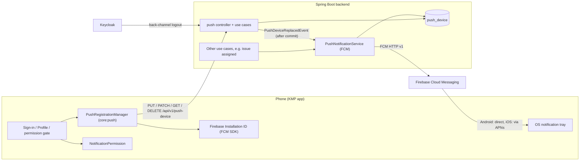
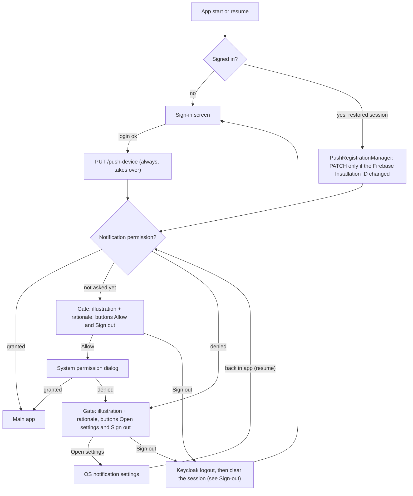
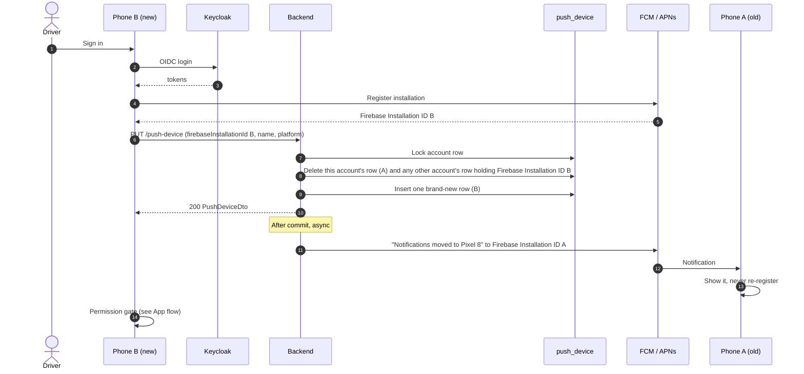
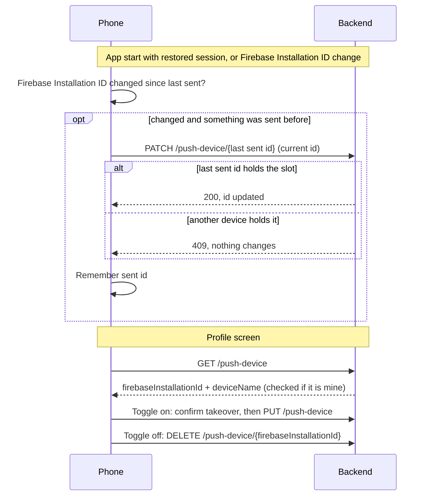
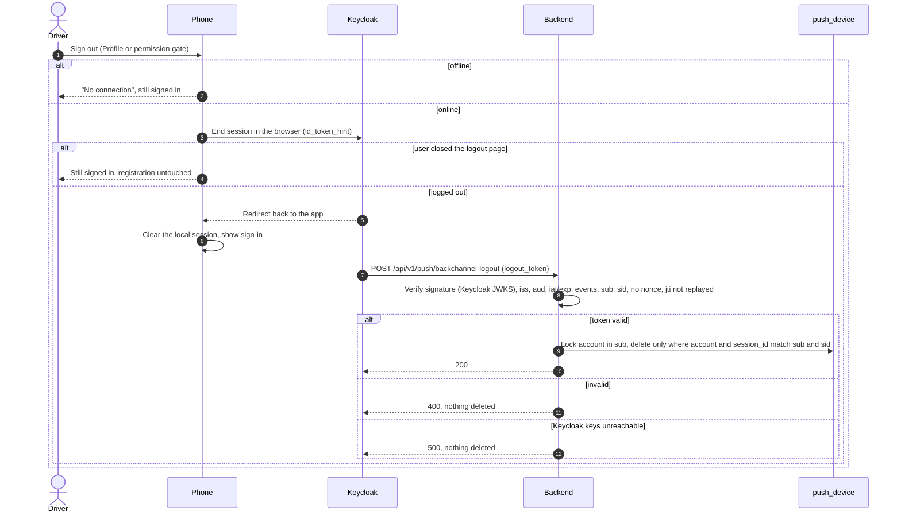
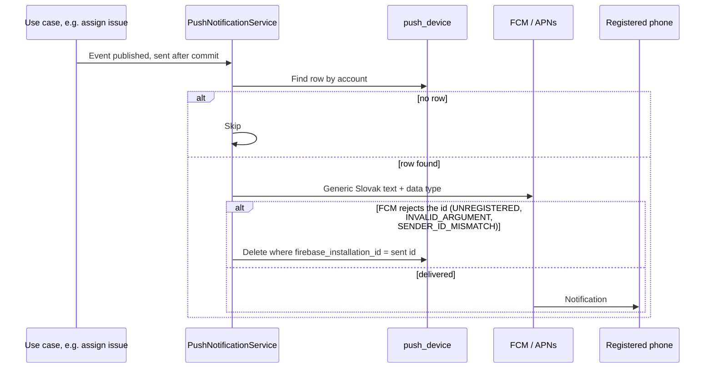

# Push Notifications

How TruckTrack delivers push notifications from the backend to the Android and iOS apps.

## Rules

- **One push device per user.** Registering a device takes over from the devices that held the slot
  before; every previous device of the account receives exactly one "notifications moved to …"
  notice, except the re-registering device itself, and the first-ever registration sends nothing.
  The backend keeps one device per account by locking the account row on every change; the database
  alone guarantees only that a Firebase Installation ID belongs to a single account.
- **Every login registers the device**, regardless of the OS notification permission — whichever way
  the login completes (including a login the app resumes after Android killed it during the browser
  step). The Profile toggle registers it too. App start and identifier refresh never register — they
  can only update the identifier of a device that already holds the slot, so an old device can't
  steal the slot back.
- **The app requires notification permission.** Without it, a blocking screen explains why and
  offers "Allow" / "Open settings" and "Sign out". Nothing else is reachable.
- **The Firebase Installation ID is the only device identifier.** FCM registers each app
  installation under a Firebase Installation ID; the backend targets pushes with it, and the app
  identifies itself with it. It changes on reinstall, cleared app data, or restore to a new device —
  all of which also end the login, so the next login registers the new id. If it rotates while the
  user stays logged in, the app proves it held the slot by sending the previous id it registered.
- **FCM on both platforms.** FCM delivers to iOS through APNs, so the backend only talks to FCM.
  Registration follows the current Firebase guides (Firebase Installation ID registration, not the
  deprecated registration token).
- **Notification text is generic** and always in Slovak — the backend renders it from
  `messages.properties`, the app sends no language. A stray notification on a shared device reveals
  almost nothing. Today there are two pushes: the move notice ("Upozornenia boli presunuté" /
  "Upozornenia z TruckTrack teraz prichádzajú na zariadenie {0}.") and the weekly checklist
  reminder (see `checklist.md`); future pushes should stay as vague, e.g. "Máte pridelenú novú
  požiadavku".

## Overview



## App flow



## Login on a new device (takeover)



## Everyday device flows



## Sign-out (back-channel logout)

The app sends nothing about the push device when signing out. Keycloak tells the backend through
OIDC back-channel logout, and the backend removes only the push registration belonging to the
signed-out session. Registration stores the authenticated access token's `sid` alongside the
device. Logging out on phone B leaves phone A registered when A holds the notification slot;
logging out on A removes A's registration.



- The device gets no "moved" notice — it was signed out on purpose.
- A missing, blank or non-string `sid` is rejected with `400`, without deleting anything. There is
  no account-wide fallback. A valid logout for a session without a matching registration returns
  `200` and leaves other registrations untouched.
- A delayed logout from an older session cannot delete the device's registration after it has
  registered under a new session, even when its Firebase Installation ID is unchanged.
- The back-channel request runs server to server and isn't ordered with the app's redirect; the
  app doesn't wait for it.
- Sign-out is refused offline because a local-only sign-out would never reach Keycloak, so the
  device would stay registered.
- Keycloak only sends back-channel logout to a confidential client with a **Backchannel Logout
  URL** — see Setup.

## Sending a notification



## API contract

DTOs live in `shared` (`com.momosi.trucktrack.shared.push`) for the client and are mirrored
field-for-field in `server/module-api` (`sk.momosilabs.truckTrack.api.push.dto`), like every other
domain.

| Endpoint | Request | Response |
|---|---|---|
| `PUT /api/v1/push-device` | `PushDeviceRegistrationDto(firebaseInstallationId, deviceName, platform)` | `200 PushDeviceDto`. Takes the slot over. |
| `PATCH /api/v1/push-device/{firebaseInstallationId}` | `PushDeviceUpdateDto(firebaseInstallationId)` — the path holds the id the app sent last, the body the current one | `200` when the path id holds the slot, otherwise `409`. Never takes the slot over. |
| `GET /api/v1/push-device` | – | `200 PushDeviceDto(firebaseInstallationId, deviceName, platform, registeredAt)`, or `204` when no device is registered. With several rows the most recently registered one — the account's current device. |
| `DELETE /api/v1/push-device/{firebaseInstallationId}` | – | `200`. Deletes every one of the account's rows holding this id, so a duplicate could never survive; other accounts' rows are untouched. |
| `POST /api/v1/push/backchannel-logout` | Form field `logout_token` — called by Keycloak, not by the app | `200` after the token is verified; deletes only registrations matching both `sub` and `sid`. Missing or invalid `sid` returns `400` without deletion. |

Only the registration `PUT` is retried by the app (on connection errors and 5xx, a few times with
backoff); every other request fails immediately.

### Push payload

Every push is an FCM *notification* message (so the OS shows it while the app is in the background)
with a `data` block:

| Key | Value |
|---|---|
| `type` | A `PushMessageTypeDto` name: `DEVICE_UNREGISTERED` or `CHECKLIST_REMINDER` |
| `deviceName` | `DEVICE_UNREGISTERED` only: the device that took over |
| `deepLink` | Optional HTTPS app link to open when the notification is tapped, e.g. `https://transroute.org/checklist` (sent by `CHECKLIST_REMINDER`) |

Android messages use the notification channel `trucktrack_notifications`; the app creates that
channel at startup and declares it as FCM's default channel.

Notification-tap navigation depends on `deepLink`, not on `type`, so new message types can reuse
existing app-link destinations without a dedicated navigation handler. The checklist reminder
(Monday stage) is sent as:

```json
{
  "notification": {
    "title": "Týždenná kontrola vozidla",
    "body": "Nezabudnite tento týždeň vyplniť kontrolu vozidla."
  },
  "data": {
    "type": "CHECKLIST_REMINDER",
    "deepLink": "https://transroute.org/checklist"
  }
}
```

The backend schedules `CHECKLIST_REMINDER` (see `checklist.md`); the client has no handler for it,
so it parses as unrecognized and only its `deepLink` matters. Send `deepLink` as a string in FCM's `data` block, not in
`notification`, and leave Android `click_action` unset so background notifications open the
launcher activity. No browser or external URL opener is used: `AppLinksManager` validates the
existing host/path allowlist, discards links while signed out, and queues accepted links until
the app's notification-permission gate is passed. Missing links only open the app; unsupported
or malformed URLs are rejected without changing navigation.

## Backend

- Table `push_device`: `id` (PK), `account_id` (NOT NULL FK → `account.id`),
  `firebase_installation_id` (unique, `uk_push_device_firebase_installation`), `device_name`,
  `platform`, `registered_at_utc`, `updated_at_utc`, `session_id`. The unique `firebase_installation_id` is the
  only uniqueness the database enforces — it guarantees a Firebase Installation ID belongs to
  exactly one account. Multiple rows per account are allowed at DB level; one device per account is
  an application-layer business rule, enforced because every mutating path (register, PATCH, delete,
  FCM-rejection cleanup, back-channel logout) first takes a pessimistic lock on the account row
  (`SELECT … FOR UPDATE`).
  Deleting the account's rows by Firebase Installation ID removes every match rather than a single
  row — a defensive tolerance, since the unique `uk_push_device_firebase_installation` keeps
  duplicate `(account, firebase_installation_id)` rows unstorable today anyway.
- `registerPushDevice` requires a non-blank string `sid` from the authenticated access token
  (`400` otherwise, before changing registrations), locks the account row, deletes every row whose `account_id` is the current
  account or whose `firebase_installation_id` is the incoming one — the account's own previous row
  plus any other account's row squatting that id — and inserts one brand-new row. `registered_at_utc`
  therefore timestamps the current row: re-registering, even with the same Firebase Installation ID,
  resets it, and the device name and platform are re-synced because it is a fresh insert. The
  account's distinct Firebase Installation IDs are snapshotted before the delete and one
  `PushDeviceReplacedEvent` is published per previous id that differs from the newly registered one
  — so if several rows ever accumulated, every replaced device receives the "notifications moved
  to …" push exactly once, after commit, asynchronously; the re-registering id never receives it
  and the first-ever registration publishes no event at all.
  The new row stores that token's `sid`, so re-registration also replaces the session binding.
  The session identifier is internal correlation metadata, not an authentication credential:
  it stays in the backend database and signed HTTPS token exchanges, never in push payloads,
  push-device API responses or logs. The app does not supply a separate session-id field.
- `updatePushDevice` locks the account row, requires the path Firebase Installation ID to be the id
  currently stored on the account's row (`409` otherwise), clears any other account's row holding
  the new id and updates only `firebase_installation_id` and `updated_at_utc` — device name,
  platform and registered time are immutable after insert.
- `PushNotificationService` sends through the Firebase Admin SDK (`Message.setFid`) after the
  transaction commits. When FCM rejects the id (`UNREGISTERED`, `INVALID_ARGUMENT`,
  `SENDER_ID_MISMATCH`), the row is deleted — but only if it still holds that id. Other failures are
  only logged.
- Without Firebase credentials configured, sending is disabled, so local development works without
  them. Startup then logs `FIREBASE_CREDENTIALS_BASE64 is not set, push notifications are disabled`.
- `processBackchannelLogout` handles Keycloak's OIDC back-channel logout. The endpoint is public
  (`permitAll`); the use case verifies the logout token's signature and claims itself
  (`LogoutTokenVerifier`, with replay protection), requires both `sub` and `sid`, locks the account
  and deletes only registrations matching that account and session. The token is marked processed
  after the deletion transaction commits. This is the only way a sign-out removes the device.

## Client

- `core:push` — Firebase Installation ID access, notification permission, the API client,
  `PushRegistrationManager` (`state`, `registerThisDevice`, `unregisterThisDevice`, `refreshState`)
  and `PushMessageDispatcher` for incoming pushes.
- `feature:notification-permission` — the blocking permission gate. It is an ordinary root
  destination (`NotificationPermissionNavKey`) and never navigates itself: `app:shared` derives one
  `AppAccess` from the login and the permission (signed out › permission missing › ready) and
  navigates to sign-in, the gate or the issues list whenever it changes. App links wait until access
  is ready. Being the root of the back stack, Android back exits the app.
- `PushRegistrationManager` is the single owner of everything the app sends about this device: it
  registers on every completed login (also a login resumed after process death), sends the new
  Firebase Installation ID when it changes (PATCH, only while this device holds the slot), resets
  its state on sign-out, and serves the Profile toggle (`registerThisDevice` / `unregisterThisDevice`
  / `refreshState`). Registration waits for the Firebase Installation ID; if the request still fails
  after its retries, the error is shown and the user can retry from Profile — there are no delayed
  retries, so an old device can never take the slot back later.
- Incoming pushes go through `PushMessageDispatcher`, which parses them and hands them to every
  `PushMessageHandler` (features implement one per message type) and to its `messages` flow for the UI.
  `DEVICE_UNREGISTERED` only refreshes the registration state; it never registers.
- Sign-out needs a connection: offline, it keeps the session and shows "No connection", because
  Keycloak must see the logout. Online, it logs out of Keycloak and clears the local session; the
  app sends nothing about the push device — Keycloak's back-channel logout tells the backend, which
  removes it. If the user closes the logout page, nothing happens to the registration.
- Firebase Installation ID registration is enabled with `firebase_messaging_installation_id_enabled`
  (Android manifest) and `FirebaseMessagingInstallationIdEnabled` (iOS `Info.plist`); the id arrives
  in `FirebaseMessagingService.onRegistered` and `MessagingDelegate.messaging(_:didReceiveRegistration:)`.
- Foreground: Android builds the notification itself in `onMessageReceived`; iOS returns
  `[.banner, .sound, .list]` from `willPresent`. Message handlers only run while the app is in the
  foreground; in the background the OS shows the notification by itself. Receiving a message
  never navigates. A notification tap forwards the optional `data.deepLink` to `AppLinksManager`
  on both platforms, including cold starts. Android handles foreground notifications through
  explicit activity intents and background FCM notifications through launcher extras; the iOS
  default-tap callback reads the same key from `userInfo`. Saved-state recreation on Android and
  notification dismissal on iOS do not replay links.
- The id the app sent last is excluded from backups (Android Auto Backup, iOS backup), so a phone
  restored from backup can't present another phone's id.
- Device names: Android uses [AndroidDeviceNames](https://github.com/jaredrummler/AndroidDeviceNames)
  (its database ends in 2022; newer phones fall back to manufacturer + model), iOS uses
  [DeviceKit](https://github.com/devicekit/DeviceKit) (e.g. "iPhone 15 Pro").

## Accepted limitations

- An expired Keycloak session doesn't unregister the device: Keycloak sends back-channel logout
  only for an actual logout, not when a session times out. Pushes keep arriving until the user logs
  out, another device takes over, or FCM reports the Firebase Installation ID as invalid. Generic
  notification text keeps this harmless. A Keycloak event listener (`LOGOUT`,
  `USER_SESSION_DELETED`) could cover it later without changing anything else.
- Registrations created before the session-binding migration have a null `session_id`: it cannot
  be reconstructed from their Firebase Installation IDs. They remain registered but cannot be
  removed by session-scoped logout until the device registers again (next login or Profile toggle).
  Identifier-only PATCH updates preserve the existing binding, including a legacy null binding.
- Without back-channel delivery (see Setup), signing out leaves the device registered.

## App Store note

App Store Review Guideline 4.5.4 says push notifications "must not be required for the app to
function". The permission gate is fine for Firebase App Distribution and internal TestFlight testers,
but a public App Store or external TestFlight review will likely reject it.

## Setup outside the repository

### Backend

`FIREBASE_CREDENTIALS_BASE64` holds the Firebase service-account key: Firebase console → Project
settings → Service accounts → *Generate new private key*, then base64 the JSON on one line
(`base64 -w0 key.json`). Never commit it and never log it. Both apps (staging and prod) are in the
same Firebase project, so one key serves both servers.

- Production: add it to `/opt/trucktrack/app/app.env`, see the truckTrack-devOps runbook (doc 07,
  section 7.2).
- Staging (`trucker-service.service`, deployed by `build-server.yml`): put the line in a root-only
  file and load it with a systemd drop-in:
  ```bash
  sudo install -m 600 /dev/null /etc/trucker-service-firebase.env   # then paste the line into it
  sudo mkdir -p /etc/systemd/system/trucker-service.service.d
  printf '[Service]\nEnvironmentFile=/etc/trucker-service-firebase.env\n' | sudo tee /etc/systemd/system/trucker-service.service.d/firebase.conf
  sudo systemctl daemon-reload
  ```

The variable takes effect on the next restart or deploy.

`CHECKLIST_REMINDER_ENABLED` switches the checklist reminder job (temporarily daily for testing;
see `checklist.md`). It
defaults to `true`, so both servers remind drivers without any setup. To stop reminders on one
server, set it to `false`:

- Production: add `CHECKLIST_REMINDER_ENABLED=false` to `/opt/trucktrack/app/app.env`, see the
  truckTrack-devOps runbook (doc 07, section 7.2).
- Staging: add a drop-in the same way as the Firebase key:
  ```bash
  sudo mkdir -p /etc/systemd/system/trucker-service.service.d
  printf '[Service]\nEnvironment=CHECKLIST_REMINDER_ENABLED=false\n' | sudo tee /etc/systemd/system/trucker-service.service.d/checklist-reminder.conf
  sudo systemctl daemon-reload && sudo systemctl restart trucker-service
  ```

### Keycloak

Configure back-channel logout as described in `server/devOps/README.md` (*Keycloak — Enable
Back-Channel Logout Delivery*): set the client's **Backchannel Logout URL** to
`https://<host>/api/v1/push/backchannel-logout` on every environment. Keycloak only delivers it to
confidential clients. Enable **Backchannel Logout Session Required** so logout tokens include
`sid`, and ensure access tokens for the app also contain the same session's `sid`. Check claim
presence locally without copying tokens or session identifiers into logs or this repository.
Check delivery by signing out and looking for the logout request's outcome in the server log.

### Android

Nothing extra: `google-services.json` already lists both application ids. The FCM HTTP v1 API is on
by default (Firebase console → Project settings → Cloud Messaging shows it as *Enabled*).

### iOS

1. Apple Developer portal → Keys → **+** → *Apple Push Notifications service (APNs)* → download the
   `.p8` (only downloadable once) and note its Key ID and the Team ID (Membership details).
2. Firebase console → Project settings → Cloud Messaging → for **both** iOS apps, upload it under
   *APNs Authentication Key* with the Key ID and Team ID. Don't use APNs certificates — the key never
   expires and covers both apps and both APNs environments.
3. Apple Developer portal → Identifiers → `com.momosi.trucktrack` and `com.momosi.trucktrack.staging`
   → tick *Push Notifications* → Save. Ignore *Configure* and its "Client SSL Certificate" text; the
   `.p8` replaces it.
4. That invalidates the provisioning profiles: regenerate the staging ad-hoc, prod ad-hoc and prod
   App Store profiles and update `IOS_STAGING_ADHOC_PROFILE_BASE64`, `IOS_PROD_ADHOC_PROFILE_BASE64`
   and `IOS_PROD_APPSTORE_PROFILE_BASE64` (see the `manage-ios-signing` skill). With an old profile
   the CI archive fails with "Provisioning profile … doesn't include the aps-environment
   entitlement".
